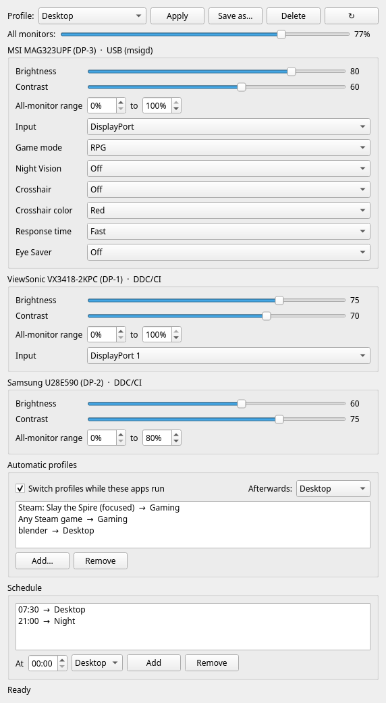

# monctl

[](https://github.com/doodersrage/monctl/actions/workflows/tests.yml)

Monitor control for Linux, with profiles, a tray icon and a settings window.

- **MSI monitors** are controlled over USB through [msigd](https://github.com/doodersrage/msigd/tree/mag323upf)
  (game mode, Night Vision, smart crosshair, response time, Eye Saver, brightness, contrast, input, KVM…).
- **Every other monitor** gets brightness and contrast over DDC/CI through `ddcutil`.
- **Profiles** capture all connected monitors at once ("Gaming", "Night", …) and apply them from the
  CLI, the tray or the window.
- **Automatic profiles** switch while an app runs (e.g. any Steam game → Gaming) and back to a default
  profile when it exits.
- **Keyboard shortcuts** (KDE Plasma 6 and other desktops with the GlobalShortcuts portal): apply
  profiles 1–4, cycle profiles, step brightness on all monitors, toggle automatic profiles.
- **Monitors that come back** after being off, unplugged or asleep are re-detected, and a profile
  that skipped them is finished on them. Settings you change from the monitor's menu are left alone.

Verified on an MSI MAG323UPF (FW V61) alongside a ViewSonic VX3418-2KPC and a Samsung U28E590.



## Safety

msigd talks to the monitor firmware directly, and the firmware does not reject unsupported writes.
monctl therefore only writes settings that were verified on hardware (written, read back, restored
and diffed against the full monitor state) and refuses these outright:

| Setting | Why |
|---|---|
| `kvm=type_c` | the monitor's USB control channel is on the monitor's own hub; switching KVM to USB-C disconnects it, and only the OSD can switch back |
| `pip` | turning PiP on resets brightness, response time, Adaptive-Sync and Zero Latency, and not all of them can be restored over USB |
| `free_sync`, `zero_latency` | writing these codes hung other MSI models |

## Requirements

- Python ≥ 3.9, PyQt6 for the tray/window
- `python-dbus` and `python-gobject` for keyboard shortcuts and focus rules (optional)
- `ddcutil` with the `i2c-dev` module loaded (DDC/CI monitors)
- `msigd` from the fork above for MSI monitors (`make TARGETOS=arch`), and access to the monitor's
  `/dev/hidraw*` node (desktop sessions usually grant this; otherwise see msigd's udev rule)

If `msigd` is not on `PATH`: `monctl config msigd /path/to/msigd` (or set `MONCTL_MSIGD`).

## Install

**Arch Linux** (not on the AUR yet; the PKGBUILD downloads the tagged release):

```
git clone https://github.com/doodersrage/monctl
cd monctl/packaging/aur && makepkg -si
sudo pacman -S --needed python-pyqt6        # for the tray and window
```

For MSI monitors, build msigd from the fork:

```
git clone https://github.com/doodersrage/msigd
cd msigd/packaging/arch && makepkg -si
```

**Other distributions:** `pip install --user "monctl[tray] @ git+https://github.com/doodersrage/monctl@v0.2.2"`,
then install `ddcutil` from your distribution and build msigd from the fork with `make`.

## Usage

```
monctl list                                   # monitors and how each is controlled
monctl status [MONITOR] [--all] [--json]
monctl set MAG323UPF game_mode=fps night_vision=ai
monctl brightness 40 [MONITOR|all]           # "all" uses brightness matching (below)
monctl set VX3418-2KPC input=hdmi1            # switch input (DDC/CI or MSI)
monctl range U28E590 0 80                     # brightness matching; "monctl range" lists
monctl schedule add 21:00 Night               # time-of-day profiles; list | remove 21:00
monctl profile save Gaming | apply Gaming | list | show Gaming | delete Gaming
monctl auto add steam:game Gaming             # automatic profiles
monctl auto add blender Work
monctl auto add steam:game Gaming --focused   # only while the game's window has focus (KDE)
monctl auto games                             # installed Steam games, for rules like steam:646570
monctl auto default Desktop                   # applied when the last matching app exits
monctl auto on | off | list | remove blender | procs
monctl watch                                  # run automatic profiles without the tray
monctl tray [--window]
```

Automatic-profile rules match a process name (case-insensitive, `.exe` optional so Proton games
match by their Windows executable) or `steam:game` for any game started by Steam (detected through
the `SteamAppId`/`SteamGameId` environment Steam gives its games), or `steam:<appid>` for one
Steam game (pick it by name in the window, or list ids with `monctl auto games`). The first matching
rule wins.
`monctl auto procs` lists what is running. Nothing is applied at startup unless a rule matches, so
a manually chosen profile is left alone.

`MONITOR` is an index from `monctl list`, a key (`MAG323UPF`), a connector (`DP-3`) or `all`.

Applying a profile sends `game_mode` first, since the monitor's game-mode presets overwrite
brightness, sharpness and other picture settings.

### Brightness matching

Different panels look different at the same brightness value. Give each monitor the range it
should use for the "all monitors" level: set **All monitors** to 50% in the window, then narrow the
**All-monitor range** of the monitors that look brighter until they match. The tray's
**Brightness (all)**, the brightness shortcuts and `monctl brightness N` (without a monitor) use it;
per-monitor sliders and `monctl set` stay raw.

### Schedule

`monctl schedule add 07:30 Desktop` and `monctl schedule add 21:00 Night` (or the window's
**Schedule** box) apply a profile when the time passes, also when it passed while the PC slept.
Nothing is applied at startup. While an automatic-profile rule is active its profile wins, and
when the game exits monctl returns to the profile scheduled for that time instead of the
"Afterwards" default.

### Inputs

Each monitor's **Input** (window, tray menu or `monctl set KEY input=…`) lists what the monitor
reports (`dp1`, `hdmi1`, … over DDC/CI; `dp`, `hdmi1`, `usbc` on MSI). The GUI asks before
switching, since the screen then shows the other source. Inputs are not part of profiles. Some
monitors accept input switching over DDC/CI but ignore it; those known to (Samsung U28E590) get no Input control.

### Only while focused (KDE Plasma)

A rule marked **Only while its window is focused** switches back when you Alt+Tab away and
returns when you focus the app again. monctl loads a small KWin script that reports the focused
window; it is loaded only while such a rule exists and unloaded when the tray quits. Without
KDE (or without `python-dbus`), these rules behave like ordinary "while running" rules.

## Keyboard shortcuts

Turn on **Keyboard shortcuts** in the tray menu. The desktop asks once to confirm them; change
them later with **Change shortcuts…** in the tray menu (or System Settings → Shortcuts → monctl).

| Shortcut (suggested) | Action |
|---|---|
| Meta+Alt+1 … 4 | Apply profile 1–4 (in `monctl profile list` order) |
| Meta+Alt+N | Next profile |
| Meta+Alt+Page Up / Page Down | Brightness ±10 on every monitor |
| Meta+Alt+A | Automatic profiles on/off |

## Troubleshooting

If the tray hits an internal error it keeps running, shows a warning, and writes the
traceback to `~/.local/state/monctl/tray.log`. Please include that file in bug reports.

## License

MIT. msigd is GPLv2 and runs as a separate program.
